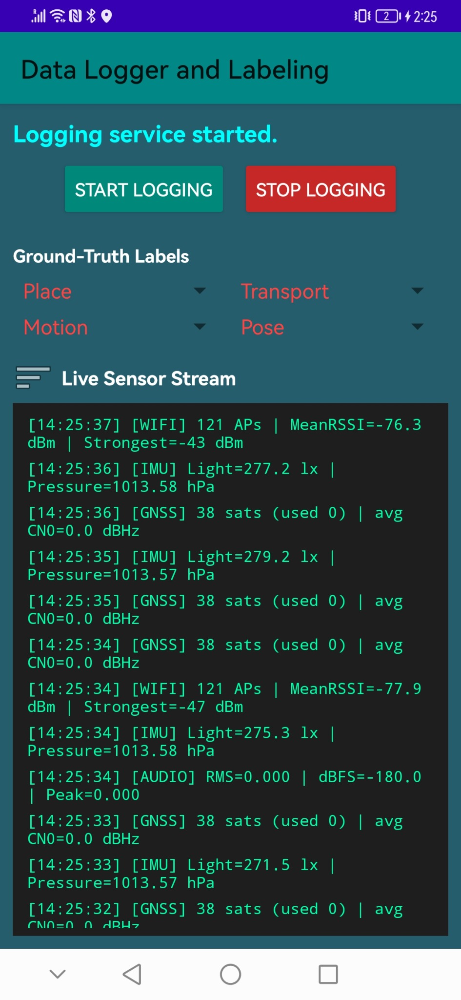
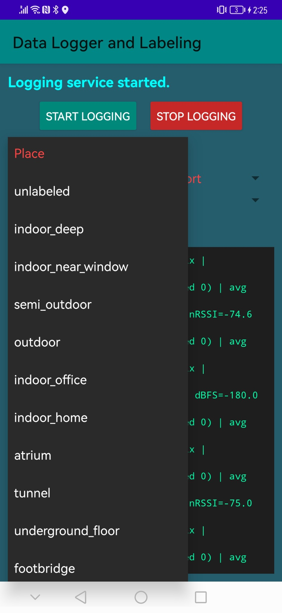
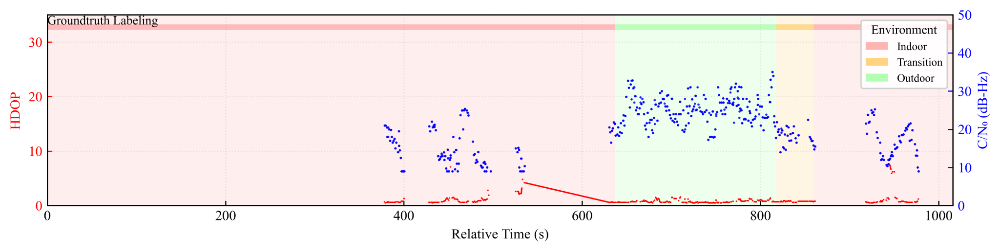
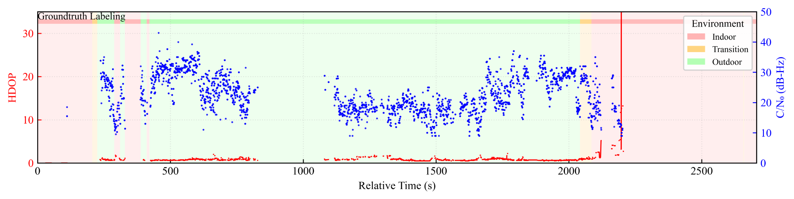
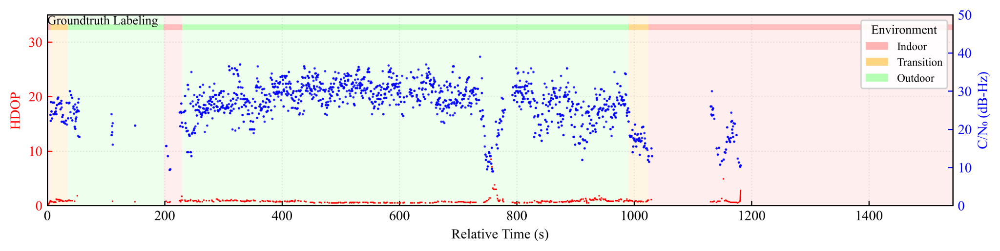

# 🌍📱 OpenMobileContextEnvSense

OpenMobileContextEnvSense is an open-source Android sensing framework and dataset ecosystem for **multimodal mobile environmental context understanding**. It targets realistic deployments where **indoor–outdoor inference**, **transition-zone ambiguity**, and **device and usage heterogeneity** can degrade brittle rules and overfitted models.

**Paper (under review):** *Environmental-State Inference from Non-Visual Mobile Sensing: A Scoping Review of Computational Methods, Generalization, and Deployment*  
**Authors:** Ahmed Mansour, Wu Chen, Jingxian Wang, Mahmoud Adham, Mohamed Elrifaee, Mostafa Mahmoud

---

## ✨ What is included in this repository

- ✅ **Public six-session dataset release** under [`data/datasets/public_2026_11_07/`](data/datasets/public_2026_11_07/) (154.8 minutes of recordings; 120 context-label events)
- 📱 **Android Studio Java label-logger source** under [`android/IndoorOutdoorDetection/`](android/IndoorOutdoorDetection/) (source released; clean build not independently verified)
- 🧾 **Dataset schema, de-identification and checksums** in [release README](data/datasets/public_2026_11_07/README.md) and [manifest](data/datasets/public_2026_11_07/manifest.json)
- 📈 **Example plots** and 🖥️ **app UI screenshots** under `assets/`
- 📓 **Analysis notebook** under `notebooks/`
- 🛠️ Minimal scripts for validation and session summarization under `scripts/`

---

## 🖥️ App UI preview (logging and labeling)

<p align="center">
  
  
</p>

---

## 🏷️ Ground-truth label categories

The logger supports four synchronized label channels: **place or environment**, **transportation mode**, **motion state**, and **device pose**. The label state is shared across streams for consistent temporal alignment.

### 🌍 Place or environment (examples)
```text
Place or Environment
├─ Core: unlabeled, indoor_deep, indoor_near_window, semi_outdoor, outdoor
├─ Indoor places: indoor_office, indoor_home, shopping_mall, atrium, airport_terminal
├─ Transition and structures: glass_entrance, covered_walkway, footbridge, balcony, tunnel
├─ Vertical and mobility nodes: elevator, indoor_elevator, outdoor_elevator, indoor_stairwell, outdoor_stairwell
└─ Underground and parking: underground_floor, underground_parking_garage, metro_station
```

### 🚆 Transportation mode (examples)
```text
Transportation mode
├─ unknown
├─ on_foot
├─ bicycle, scooter
├─ car, bus
├─ train, metro
└─ airplane
```

### 🚶 Motion state (examples)
```text
Motion state
├─ unknown
├─ standing, walking, walking_with_stops
├─ jogging, running
└─ sitting, in_vehicle
```

### 📲 Device pose (examples)
```text
Device pose
├─ unknown, on_table
├─ hand_texting, hand_holding_horizontal, hand_calling_ear
├─ pocket_front, pocket_back
├─ bag, armband, mounted_dashboard
└─ mixed
```

---

## 🧪 Sensor taxonomy and logged fields

```text
LoggerService (Android)
├─ SensorLogger
│  ├─ Accelerometer (ax, ay, az)
│  ├─ Gyroscope (gx, gy, gz)
│  ├─ Magnetometer (mx, my, mz)
│  ├─ Rotation vector (rvx, rvy, rvz, rvw)
│  ├─ Light (lux), Pressure (hPa), Proximity (cm)
│  └─ Timestamps (ts_ms, t_ns)
├─ WifiLogger
│  ├─ Scan summary (AP count)
│  ├─ Per-AP records (BSSID, SSID, frequency, RSSI)
│  └─ Timestamp (ts_ms)
├─ CellLogger
│  ├─ Snapshot (RAT, MCC/MNC, CI, PCI, TAC/LAC, registered)
│  ├─ Signal (dBm, RSRP, RSRQ, RSSNR, CQI, TA)
│  └─ Timestamp (ts_ms)
├─ GnssLogger
│  ├─ Fix (lat, lon, alt, speed, bearing, accuracy)
│  ├─ SV status (const, svid, cn0, elevation, azimuth, used)
│  └─ Timestamp (ts_ms)
└─ AudioLogger (features only)
   ├─ RMS, dBFS, peak
   ├─ Periodic sampling, no audio stored
   └─ Timestamp (ts_ms)
```

**Timestamping**
- `ts_ms` is the primary time base used for cross-stream alignment.
- `t_ns` is provided when high-resolution sensor timestamps are available.

---

## 📦 Datasets

### ✅ Public six-session field release (2026-11-07)
- [Six labeled, privacy-reduced session archives](data/datasets/public_2026_11_07/), `session_01.zip` through `session_06.zip`
- [Data description and limitations](data/datasets/public_2026_11_07/README.md) and [file manifest / checksums](data/datasets/public_2026_11_07/manifest.json)
- [Android Studio logging and labeling application source](android/IndoorOutdoorDetection/) and [release description](docs/R1_RELEASE_2026_11_07.md)

**Privacy safeguards in the public release**
- Absolute GNSS coordinates, raw NMEA, network identifiers, and original timestamps are excluded or transformed as described in the release documentation.
- Signal measurements and relative timing are retained; audio is represented by features, not raw recordings.
- De-identification reduces but does not eliminate re-identification risk; dataset permissions and consent remain the responsibility of the data provider.

The six recordings illustrate data collection and annotation. They are **not** six independent benchmark datasets, and they are **not** part of the 108 reports / 105 independent families systematically reviewed in the accompanying article.

---

## 📈 Example plots from the sample analysis

<p align="center">
  
</p>

<p align="center">
  
</p>

<p align="center">
  
</p>

---

## 🚀 Quickstart (local)

```bash
python -m venv .venv
# Windows: .venv\Scripts\activate
pip install -r requirements.txt

python scripts/summarize_session.py --zip data/datasets/IOD_Record_1761144837784_public.zip
```

---

## 🗂️ Repository structure

```text
OpenMobileContextEnvSense/
├─ android/        # Android Studio source release
├─ assets/
├─ data/
├─ docs/
├─ notebooks/
├─ paper/
├─ scripts/
├─ .gitignore
├─ CITATION.cff
├─ LICENSE
├─ README.md
└─ requirements.txt
```

---

## 🧾 Citation
Please cite the accompanying paper, see `CITATION.cff` and `paper/citation.bib`.

---

## ⚖️ License
- Code is released under the MIT License, see `LICENSE`.
- Data is released under CC BY 4.0, see `data/LICENSE`.
